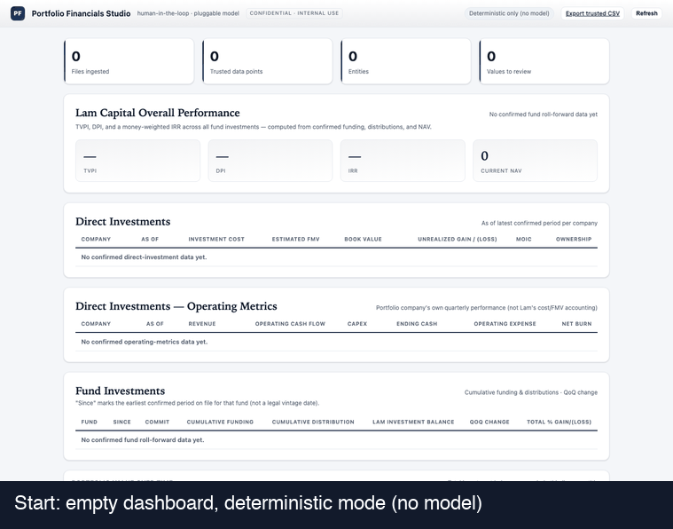
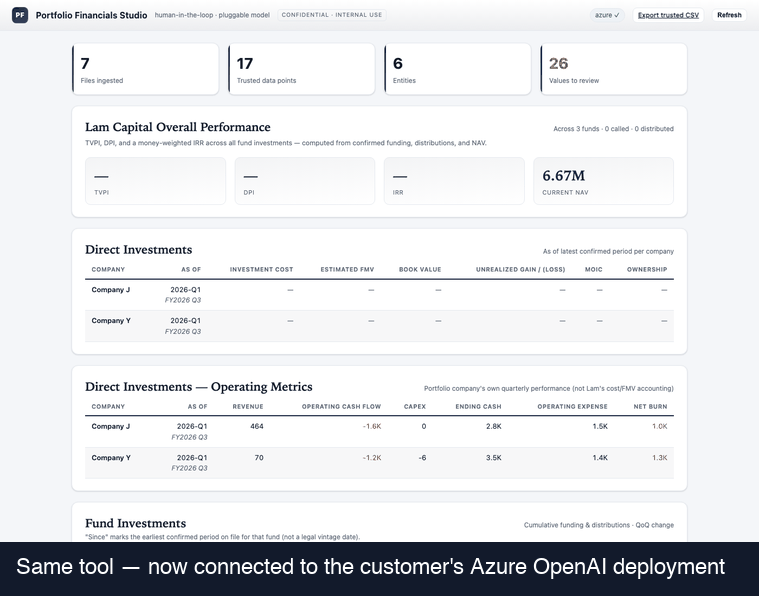
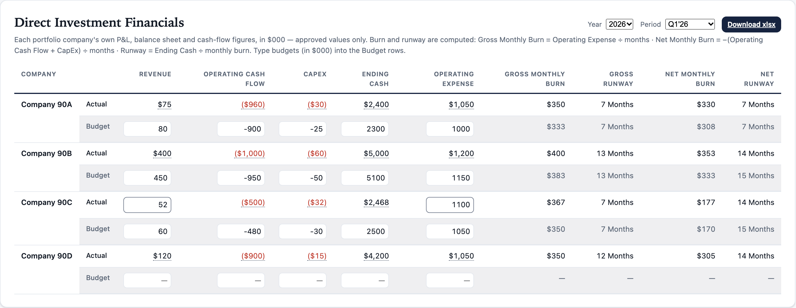
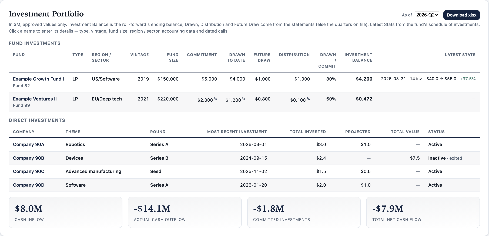

<div align="center">

# 📊 Portfolio Financials Studio

**Audit-ready numbers from messy investment reports — read, reconciled, reviewed by a person,
and delivered in the team's own workbooks.**

[](https://github.com/jfjustin/portfolio-financials-studio/actions/workflows/azure-deploy.yml)


[See it in action](#-see-it-in-action) · [Highlights](#-highlights) · [Architecture](#%EF%B8%8F-architecture) ·
[Quick start](#-quick-start) · [User guide](GUIDE.md) · [Architecture notes](docs/ARCHITECTURE.md)

</div>

---

Investment teams receive their quarterly numbers in every format there is: capital-account
statements, fund financial statements, scanned PDFs, portfolio companies' own P&Ls, Excel
workbooks and CSV exports. **Portfolio Financials Studio** reads them with rule-based parsers
first and a vision-capable model only where rules can't, maps every figure to a canonical metric,
reconciles it before it is recorded, and routes anything uncertain to a person. Only approved
values reach the dashboards, the Delta Lake tables behind Power BI, and the two quarterly Excel
deliverables the team sends.

| How it reads | Backend | Data boundary |
|---|---|---|
| 🔒 **Deterministic** *(default)* | Rule-based parsers only — `pdfplumber`, `openpyxl` | Nothing leaves the machine; no credentials |
| 🏢 **Azure OpenAI** | The customer's own deployment, text and vision | Stays inside the customer's Azure tenant |
| ☁️ **OpenAI** · 🖥️ **Ollama** | Public cloud, or a local model | Quick trials · fully offline |

## ✨ Highlights

- 📥 **Reads what arrives** — native and scanned PDF, XLSX/XLSM/XLS and CSV; side-by-side statements,
  multi-period columns, European number formats, figures stated "in $000".
- 🧮 **Deterministic first** — exact rules do the reading; the optional model step reads only what the
  rules can't (including scanned pages), and every model reading goes to review.
- 🔁 **Reconciles before it records** — last quarter's ending carries forward, year-to-date statements are
  de-cumulated into quarters, and every quarter must add up (beginning + activity = ending).
- 🧑‍⚖️ **Human in the loop** — confirm, correct or reject each value; an append-only audit trail records
  every change; nothing unreviewed reaches a report.
- 🚩 **Flags gaps, never guesses** — *missing*, *to review*, *mismatch*, *estimate* and *unread* items, each
  with a one-click fix: open the file, re-read it, or enter the figure by hand.
- 📑 **Two quarterly deliverables** in the team's own workbook layouts — *Direct Investment Financials*
  (budget vs. actual, burn and runway) and *Investment Portfolio* (fund sheets linked to a summary).
- 🧠 **Format memory** — learns each fund's statement wording from reviewers and confirmed values; no
  retraining.
- 🏞️ **Lakehouse-ready** — Land → Bronze → Silver → Gold Delta tables on ADLS Gen2 or Fabric OneLake, plus
  versioned Parquet exports for Power BI.
- 🚀 **Shipped to Azure** — GitHub Actions runs 172 end-to-end checks before every deploy to App Service;
  Entra ID SSO and keyless (managed identity) access to Azure services.

## 🎬 See it in action

Two recordings of the complete workflow — upload → extraction → sectioned
review → edit a value → human confirm → portfolio sections → export — on the
same tool, two model configurations:

| Deterministic (no model) | Azure OpenAI (customer's own deployment) |
|---|---|
|  |  |
| Zero credentials, nothing leaves the machine. | A required field is genuinely missing — the model suggests three values (flagged, capped at 50% confidence), a human overwrites one, and TVPI/DPI/NAV go from "—" to real numbers once confirmed. |

## 📑 The quarterly deliverables

**Direct Investment Financials** — each portfolio company's quarter: budget vs. actual, gross and net
monthly burn, runway. Exported as one sheet per company.

[](docs/images/direct-investment-financials.png)

**Investment Portfolio** — funds and direct investments as of a quarter, with the portfolio's cash
flows. Exported as per-fund sheets linked to a summary sheet.

[](docs/images/investment-portfolio.png)

<sub>Screenshots use the made-up companies and funds generated by `samples/make_samples.py`.</sub>

<details>
<summary><b>How each figure is sourced</b></summary>

<br>

**Direct Investment Financials** (`app/direct_investments.py`, `app/extractors/company.py`) — per
company, Budget | Actual for each quarter and the year, in $000:

| Row | Actual comes from |
|---|---|
| Revenue | P&L "Total for Income" / "Total revenue" / "Revenue" |
| Operating Cash Flow | Cash flow "Net cash provided by (used in) operating activities" |
| CapEx | Fixed-asset purchases under investing activities (not deposits or securities) |
| Ending Cash | Balance sheet "Total for Bank Accounts" / "Cash and cash equivalents", checked against the cash flow's closing cash |
| Operating Expense | P&L "Total for Expenses" / "Total operating expenses" |
| Gross / Net Monthly Burn | Operating expense ÷ months · −(operating cash flow + CapEx) ÷ months |
| Gross / Net Runway | Ending cash ÷ monthly burn, in whole months (n/a when cash-flow positive) |

Each figure is matched on its whole wording inside the right statement ("Deferred Revenue" is never
revenue) and read from the column covering the quarter — the "Total" of Jan | Feb | Mar, the
"Three Months Ended" column rather than a prior year beside it, never a budget column. Scanned
statements go to the vision model (or Tesseract). The workbook has a **Sources** sheet naming the file
and line behind every actual.

**Investment Portfolio** (`app/portfolio.py`) — one sheet per fund with the template's cells
(Investment Name B2 … Drawn to Date B13, Distribution to Date F13), the **Latest Stats** row (date,
number of investments, cost, value, gain %), the dated **Invested** history and the accounting
team's equity-investments summary; one sheet per direct investment; and a **Summary-Cash Flows**
sheet whose cells reference those sheets (`='Fund 1'!$B$13`, …) with the template's cash-flow
totals. Investment Balance is the roll-forward's ending balance; drawn, distributed and remaining
commitment come from the statements' since-inception lines; Latest Stats from the fund's schedule of
investments. Master data (type, vintage, fund size, region / sector, GL account…) and dated capital
calls are entered once per fund.

**Gaps are flagged, never guessed.** A figure no approved file shows is *missing*; one read but not yet
approved is *to review*; approved figures that disagree, or a quarter that doesn't add up, are a
*mismatch*. A person can type a figure in from the dashboard — it's kept in its own "Entered
manually" submission, confirmed, flagged `manual_entry` and audited.

</details>

## 🏗️ Architecture

```
  PDF · scanned PDF · XLSX · CSV
                 │  upload
                 ▼
  ┌────────────────────────────┐
  │ 1  Land                    │  original kept exactly as received ............ Land
  ├────────────────────────────┤
  │ 2  Extract                 │  rule-based parsers (pdfplumber, openpyxl)
  │    deterministic first     │  + model step for the rest (Azure OpenAI text & vision)
  ├────────────────────────────┤
  │ 3  Map & reconcile         │  canonical metrics · format memory · carry-forward
  │                            │  · YTD de-cumulation · balance checks ......... Bronze
  ├────────────────────────────┤
  │ 4  Human review            │  confirm · correct · reject · enter by hand
  │                            │  · append-only audit trail .................... Silver
  ├────────────────────────────┤
  │ 5  Publish                 │  approved values only ......................... Gold
  └─────────────┬──────────────┘
                ├──▶  Dashboard — TVPI · DPI · IRR · quarterly roll-forward · grand ledger
                ├──▶  Excel — Direct Investment Financials · Investment Portfolio
                └──▶  Power BI / Fabric — Delta tables (ADLS Gen2 / OneLake) · Parquet exports
```

**The lake is the system of record, Fabric the analytics backbone, Azure AI does the reading.**
Land keeps every original; Bronze every line read, with its page or cell; Silver every standardized
value; Gold only approved values, with entity, period and metric dimensions and a reporting version
per entity and period. See [docs/ARCHITECTURE.md](docs/ARCHITECTURE.md).

## 🧰 Tech stack

| Layer | Technology |
|---|---|
| Backend | Python 3.12 · FastAPI · Pydantic · SQLAlchemy Core |
| Document reading | pdfplumber · openpyxl · Tesseract (optional) |
| AI | Azure OpenAI (text and vision) · OpenAI · Ollama — one pluggable interface |
| Storage | SQLite · Azure SQL / PostgreSQL · Azure Blob for source documents |
| Data platform | Delta Lake (`deltalake`, PyArrow) on ADLS Gen2 or Microsoft Fabric OneLake · Parquet exports |
| Frontend | Plain JavaScript with SVG charts — no external CDNs, fonts or scripts |
| Cloud & DevOps | Azure App Service · GitHub Actions · Docker · Azure Container Apps · Entra ID · managed identity |
| Testing | End-to-end suite of 172 checks on synthetic documents, run before every deploy |

## 🚀 Quick start

```bash
git clone https://github.com/jfjustin/portfolio-financials-studio.git
cd portfolio-financials-studio
pip install -r requirements.txt          # core dependencies; model SDKs are optional
python samples/make_samples.py           # synthetic documents to try
./run.sh                                 # → http://127.0.0.1:8713
```

Drag files onto the upload area, open a submission to review it, then confirm. Run the test suite
with `python tests/test_e2e.py`. To read with your own Azure OpenAI deployment:

```bash
export LLM_PROVIDER=azure
export AZURE_OPENAI_ENDPOINT=https://your-resource.openai.azure.com
export AZURE_OPENAI_DEPLOYMENT=your-deployment-name
export AZURE_OPENAI_API_KEY=...           # or keyless: AZURE_USE_ENTRA_ID=true
./run.sh
```

## 🛡️ Why the numbers are trustworthy

No extractor — model or otherwise — can guarantee correct figures on its own. Trust is built in layers:

1. **Deterministic parsing first.** Standard sheets and native PDFs are parsed by exact rules, never
   guessed. In multi-sheet workbooks the primary statement sheet is detected, so values aren't pulled
   off a look-alike summary tab.
2. **Reconciliation.** Assets = Liabilities + Net Assets; Income − Expenses = Net Income; equity income =
   ownership × JV net income; fair value − cost = unrealized; MOIC = FV / cost; the capital-account
   roll-forward (beginning + activity = ending). Anything that fails goes to review.
3. **Human in the loop.** Every low-confidence, flagged or model-suggested value is surfaced for a person.
   Only high-confidence values that pass every check (`auto`) and reviewer-`confirmed` values feed
   reports and exports.
4. **Full audit trail.** Every value and every change (old → new, who, when, why) is recorded append-only.
   Money is stored as exact decimals, never floats.

The model is a reader of last resort, and its output is **always** reviewed — the guarantee never rests
on the model.

## 📚 Documentation

| Guide | What's in it |
|---|---|
| [User Guidebook](GUIDE.md) | Screen-by-screen workflow: upload, review, approve, deliverables, troubleshooting |
| [Architecture](docs/ARCHITECTURE.md) | The medallion lake, ADLS Gen2 → OneLake, Power BI over Delta tables |
| [Fabric / Power BI integration](docs/FABRIC_INTEGRATION.md) | Export contract, landing options, DAX starters and SQL views |

<details>
<summary><b>Dashboard and the grand ledger</b></summary>

<br>

- **Overall Performance** — TVPI, DPI and a money-weighted IRR across all fund investments; TVPI and
  DPI are the Portfolio Summary's fund row, so the two never disagree (`app/performance.py`).
- **Portfolio Summary** — direct investments by status (current / impaired / exited), funds, and all
  investments by portfolio group: cost or paid-in, total value, book value, impairment, proceeds,
  realized / unrealized / total gain, gain %, TVPI, DPI and AUM, in USD with per-quarter rates;
  cells resting on an estimate are marked. Also the workbook's Dashboard sheet.
- **Holdings sheet** — one .xlsx / .csv fills every company's holding record (cost, value, round,
  dates, impairment, group); unreadable rows are reported, never half-applied.
- **Direct Investments** — per company: investment cost, estimated FMV, book value, unrealized
  gain/(loss), MOIC, ownership.
- **Direct Investment Financials** and **Investment Portfolio** — the two quarterly deliverables, each
  with **Download xlsx** in the team's workbook layout.
- **Portfolio value over time** — total investment balance per period, with a thin line per entity;
  each period shows its calendar and fiscal-year label (e.g. "2026-Q1" / "FY2026 Q2").
- **Quarterly roll-forward** — Beginning → Funding → … → Ending per entity and calendar quarter. Each
  quarter's beginning carries forward the previous ending, year-to-date statements are de-cumulated, and
  every adjustment is badged and sent to review.
- **Grand ledger** — every trusted figure from every company and period in one filterable table,
  grouped into Assets & Balances / Income & Profit / Distributions & Capital Flows / Performance Ratios.

</details>

<details>
<summary><b>Reporting integration (Microsoft Fabric / Power BI)</b></summary>

<br>

The app is the system of record; Fabric / Power BI is the reporting layer. Output is published as
versioned tables with a frozen schema (`schema_version 1.0`):

| Table | Grain | Key |
|---|---|---|
| `fact_financial_metric` | one row per entity × period × metric | `fact_key` |
| `dim_entity` | one row per entity | `entity_name` |

```bash
curl -O http://127.0.0.1:8713/api/fabric/fact_financial_metric.parquet   # recommended
curl -O http://127.0.0.1:8713/api/fabric/dim_entity.parquet
curl    http://127.0.0.1:8713/api/fabric/schema                          # contract JSON
```

Parquet keeps money as `decimal(38,6)`, and only approved rows are exported, so a dashboard never
shows an unreviewed figure. With `LAKE_BACKEND=adls` or `onelake` the same data lands as Delta tables
(Land, Bronze, Silver, Gold) after every change. See [docs/FABRIC_INTEGRATION.md](docs/FABRIC_INTEGRATION.md).

</details>

<details>
<summary><b>Model providers and choosing a model</b></summary>

<br>

| `LLM_PROVIDER` | Model runs | Data boundary | Use when |
|---|---|---|---|
| `none` *(default)* | — | nothing leaves the machine | demos, fully deterministic runs |
| `azure` | the customer's Azure tenant | inside their Azure subscription | enterprise / confidential data |
| `openai` | public OpenAI cloud | leaves to OpenAI | quick trials |
| `ollama` | local machine | nothing leaves the machine | fully offline with a model |

With a model configured, statements the parser can't fully read go to dedicated model steps: investor
capital accounts (the investor's column, the current quarter's column, since-inception lines),
fund-level reports (the investor's share worked out from the fund's figures and its commitment),
schedules of investments, and portfolio companies' own statements — text or scanned pages. Code, not the
model, parses and sums the printed figures it points to.

The model is whatever deployment `AZURE_OPENAI_DEPLOYMENT` names. It needs JSON output and image input
(for scans); `LLM_REASONING_EFFORT=high` makes reasoning models read more carefully. Benchmarked on four
hard statements (two-column, scanned, fund-level, reserves workbook):

| Deployment | Result | Time per file |
|---|---|---|
| GPT-6 Astra (flagship) | all correct | 19–52 s |
| GPT-6.1 Sol (near-Astra, ~1/5 the price) | all correct | 21–39 s |
| gpt-5-mini | one misread | 25–48 s |

Keyless access: set `AZURE_USE_ENTRA_ID=true` and authenticate with `DefaultAzureCredential` (managed
identity, `az login` or environment credentials) — no key stored anywhere.

</details>

<details>
<summary><b>Authentication</b></summary>

<br>

| `AUTH_MODE` | Gate | Use when |
|---|---|---|
| `none` *(default)* | open | local, single user |
| `password` | one shared workspace password (`APP_PASSWORD`) | quick private deployments |
| `entra` | **Microsoft Entra ID SSO** (OIDC via MSAL) | enterprise |

```bash
AUTH_MODE=password APP_PASSWORD='choose-one' SESSION_SECRET=$(openssl rand -hex 32) ./run.sh
AUTH_MODE=entra ENTRA_TENANT_ID=... ENTRA_CLIENT_ID=... ENTRA_CLIENT_SECRET=... ./run.sh
```

Sessions are signed HttpOnly cookies; static assets, the login page and the health check are the only
unauthenticated routes. Use `password` or `entra` for any deployment other people can reach.

</details>

<details>
<summary><b>Deploy to Azure</b></summary>

<br>

**CI/CD.** Every push to `main` runs the end-to-end suite in GitHub Actions and, if it passes, deploys
to Azure App Service (`.github/workflows/azure-deploy.yml`). On App Service the database defaults to the
persistent `/home/data` mount; use `DATABASE_URL` (Azure SQL / PostgreSQL) for multi-instance production.

**From source, no Docker** (e.g. a subscription without ACR Tasks):

```bash
az group create -n rg-pfs -l swedencentral
APP=pfs-$RANDOM; echo "https://$APP.azurewebsites.net"
az webapp up --name "$APP" --resource-group rg-pfs --runtime "PYTHON:3.12" --sku B1
az webapp config set -g rg-pfs -n "$APP" \
  --startup-file "python -m uvicorn app.main:app --host 0.0.0.0 --port 8000"
az webapp config appsettings set -g rg-pfs -n "$APP" --settings WEBSITES_PORT=8000 LLM_PROVIDER=none
```

**Container Apps, inside the tenant.** `deploy/azure-container-apps.sh` builds the image (`Dockerfile`)
and creates a Container App with a system-assigned managed identity granted `Cognitive Services OpenAI
User` and `Storage Blob Data Contributor` — keyless, no secrets stored. With internal ingress and a
private endpoint on Azure OpenAI, model traffic stays on the Azure backbone and the app is reachable only
on the corporate network.

</details>

<details>
<summary><b>Report types, metric sections and fiscal year</b></summary>

<br>

| Report type | Key metrics |
|---|---|
| Fund Financials | assets, liabilities, NAV, income, expenses, contributions, distributions, fund size, schedule totals |
| Joint Venture | ownership %, JV assets / liabilities / equity, revenue, net income, carrying value |
| JV Equity Income / (Loss) | ownership %, JV net income, equity income (recomputed and checked) |
| Direct Investment | cost, fair value, unrealized / realized, ownership, MOIC, IRR |
| Direct Investment Financials | a company's own revenue, operating expense, operating cash flow, CapEx, ending cash |
| Investment Roll-Forward | Beginning → Funding → Equity income / (loss) → Return of capital → … → Ending |

Every metric carries a section — Assets & Balances, Income & Profit / (Loss), Distributions & Capital
Flows, Performance Ratios — so review, ledger and exports group figures the same way. Every period
carries its calendar label (`2026-Q1`) and fiscal label (`FY2026 Q2`) from `FISCAL_YEAR_END_MONTH`.
Metrics and wording live in `app/report_types.py`; the pipeline adapts.

</details>

## 🗂️ Project structure

```
app/
  main.py                   FastAPI app, JSON API, auth routes
  pipeline.py               ingest → extract → carry forward → validate → store → lake
  extractors/
    registry.py             routing, assembly, model steps, auto / needs-review policy
    pdf_native.py           native PDF: tables, statement lines, side-by-side blocks
    excel.py, csv_native.py workbooks and CSV, stacked column headers
    company.py              a company's own P&L / balance sheet / cash flow → five figures
    base.py                 periods, quarters, statement and column detection
    ocr.py                  optional Tesseract for scans
  llm/                      pluggable model layer: Azure OpenAI · OpenAI · Ollama
    capital_account.py      investor statements, fund-level reports, schedules of investments
    company_statements.py   scanned or unusual company statements
  carry_forward.py          quarter-to-quarter continuity, year-to-date de-cumulation
  validate.py               reconciliation checks
  terms.py                  format memory: preset, taught and learned wording
  direct_investments.py     Direct Investment Financials report + workbook
  portfolio.py              Investment Portfolio report + linked workbook
  performance.py            TVPI / DPI / IRR and summaries
  lake.py                   Land / Bronze / Silver / Gold Delta tables
  fabric_export.py          versioned Parquet / CSV exports for Power BI
  db.py                     SQLAlchemy Core storage, append-only audit trail
  storage.py · auth.py · config.py
templates/ · static/        dashboard — no external CDNs, SVG charts
tests/test_e2e.py           172 end-to-end checks on synthetic documents
samples/                    synthetic document generator (made-up companies and funds)
docs/                       architecture, BI integration spec, screenshots, demos
deploy/ · Dockerfile        Azure Container Apps script and container image
.github/workflows/          CI/CD: test, then deploy to Azure App Service
```

## 🔒 Data and privacy

- All data lives in `data/` (the database and copies of uploaded files) or in the configured Azure
  database and storage. Locally the server binds to `127.0.0.1`; there is no telemetry.
- In `azure` / `openai` modes, only the pages of a file the parser can't fully read — their text, or
  images for scanned pages — are sent to the configured model endpoint. Azure OpenAI keeps them inside
  the customer's Azure tenant.
- Samples, tests and screenshots in this repository use made-up companies and figures only.

## 🗺️ Limitations and roadmap

- **Currency** — each report keeps its own currency; totals across currencies aren't converted yet.
- **Scanned PDFs** need a vision model or Tesseract; without either, scanned pages are listed for the
  reviewer instead of read.
- **Monthly company statements** are recorded per month and not yet rolled up into a quarter.
- **Master data is entered** — vintage, region / sector and accounting details per fund, and a direct
  investment's round, cost and status, aren't in the documents themselves.
- **Schedules of investments are read as totals** (cost, fair value, number of companies), not holding
  by holding.
- **IRR is an estimate** — a money-weighted return on period-end dates, not a GP's cash-flow-exact IRR.

---

<div align="center">
<sub>Built by <a href="https://github.com/jfjustin">Justin Jiang</a> · FastAPI · Azure OpenAI · Delta Lake · Power BI</sub>
</div>
